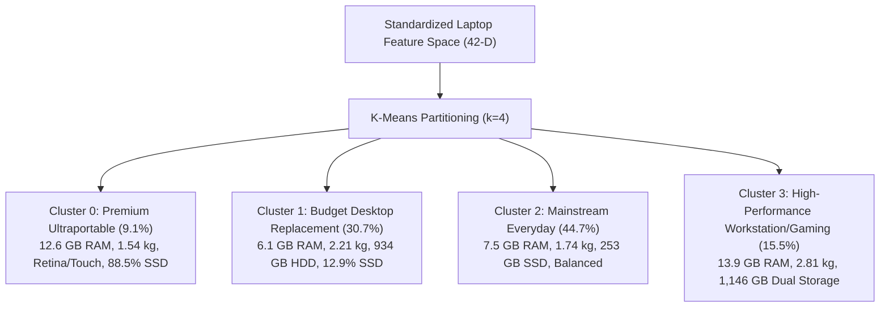

# Algorithm Performance Rationale & Dataset-to-Model Analysis

## 1. Executive Summary & Theoretical Context

In applied machine learning, the **No Free Lunch (NFL) Theorem** (Wolpert & Macready, 1997) establishes that no single learning algorithm universally outperforms all others across all possible data distributions. The optimal algorithm for a given task is strictly dictated by the **geometry of the feature space, feature covariance structures, scale discrepancies, data sparsity, and the topology of decision boundaries**.

This document details why specific machine learning algorithms succeeded or failed on our curated laptop dataset across three distinct learning paradigms:
1. **Classification** (Price Tier Categorization: Budget, Mid-Range, Premium, Flagship)
2. **Clustering** (Unsupervised Market Segmentation & Hardware Archetype Discovery)
3. **Regression** (Continuous Laptop Price Prediction in ₹ INR)

---

## 2. Dataset Topology & Feature Space Characteristics

Every algorithmic outcome observed in this project is directly traceable to the structural properties of our preprocessed dataset:

* **Observation Count ($N$)**: 1,243 rows (compact sample size).
* **Dimensionality ($D$)**: 42 input features, structured into three distinct data modalities:
  * **Continuous Numeric (7 features)**: `ram` (GB), `weight` (kg), `inches` (display diagonal), `storage_gb` (total storage capacity), `res_width` (pixels), `res_height` (pixels), `ppi` (pixels per inch).
  * **Binary Flags (4 features)**: `is_ips`, `is_touchscreen`, `has_ssd`, `has_hdd`.
  * **Sparse One-Hot Categoricals (31 features)**: `company_*` (18 brand dummies), `typename_*` (5 form-factor dummies), `opsys_*` (8 operating system dummies).
* **Target Topology**:
  * **Classification Target (`price_category`)**: 4 balanced, ordinal quartile tiers:
    * *Tier 0 (Budget)*: Price $\le Q_1$
    * *Tier 1 (Mid-Range)*: $Q_1 < \text{Price} \le Q_2$
    * *Tier 2 (Premium)*: $Q_2 < \text{Price} \le Q_3$
    * *Tier 3 (Flagship)*: $\text{Price} > Q_3$
  * **Regression Target (`price`)**: Right-skewed continuous monetary distribution ranging from ~₹9,000 to >₹325,000.
  * **Clustering Features**: Strictly the 42 intrinsic hardware features with **zero target leakage** (continuous `price` and discrete `price_category` completely excluded).

---

## 3. Classification Track: Why Specific Algorithms Won or Failed

### Leaderboard Benchmark (Test Set, Stratified Split)

| Rank | Model Architecture | Test Accuracy | Precision (Macro) | Recall (Macro) | F1-Score (Macro) |
| :---: | :--- | :---: | :---: | :---: | :---: |
| 🥇 | **Random Forest Classifier** | **70.68%** | **0.7105** | **0.7068** | **0.7042** |
| 🥈 | **Bagging Classifier (Decision Trees)** | **70.28%** | **0.7037** | **0.7028** | **0.7001** |
| 🥉 | **Extra Trees Classifier** | **68.27%** | **0.6811** | **0.6827** | **0.6815** |
| 4 | **Logistic Regression (Multinomial, L2)**| **66.67%** | **0.6698** | **0.6667** | **0.6624** |
| 5 | **Linear Support Vector Classifier** | **65.86%** | **0.6599** | **0.6586** | **0.6542** |
| 6 | **Gradient Boosting Classifier** | **65.86%** | **0.6591** | **0.6586** | **0.6580** |
| 7 | **K-Nearest Neighbors (KNN)** | **64.66%** | **0.6432** | **0.6466** | **0.6439** |
| 8 | **Decision Tree Classifier (Single CART)**| **63.86%** | **0.6389** | **0.6386** | **0.6391** |
| 9 | **AdaBoost Classifier** | **63.86%** | **0.6302** | **0.6332** | **0.6386** |
| 10 | **Gaussian Naive Bayes** | **39.36%** | **0.3216** | **0.5607** | **0.3936** |

---

### In-Depth Analysis: The Mathematical & Data Drivers

#### 1. Why Random Forest & Bagging Dominated (70.68% & 70.28%)

##### A. Non-Linear Conjunctive Pricing Rules
Commercial hardware pricing does not scale as a simple linear sum of components. Instead, commercial price brackets are governed by **boolean conjunctions (AND / OR logic)** across multiple specifications:
$$\text{Flagship} \iff (\text{RAM} \ge 16) \land (\text{has\_ssd} = 1) \land (\text{typename\_Gaming} = 1 \lor \text{company\_Apple} = 1)$$
$$\text{Budget} \iff (\text{RAM} \le 4) \lor (\text{has\_hdd} = 1 \land \text{has\_ssd} = 0)$$

Decision trees natively implement these multi-attribute intersections through sequential, axis-aligned recursive orthogonal splits ($x_j \le \theta$). A single branch can isolate an interaction like $(\text{RAM} \ge 16 \land \text{ppi} > 220)$ without requiring explicit feature engineering.

##### B. Scale and Sparsity Invariance
Our dataset presents a severe mixture of feature types:
* Continuous integers spanning up to $2,048$ (`storage_gb`) and $350$ (`ppi`).
* Highly sparse binary columns containing $>95\%$ zeros (`company_Razer`, `company_Huawei`, `opsys_macOS`).

Distance-based models (KNN) and linear models struggle with this disparity unless heavily engineered. Decision trees evaluate split points monotonically based on entropy or Gini impurity:
$$Gini(S) = 1 - \sum_{k=1}^K p_k^2$$
Because rank order is invariant to scale, trees operate seamlessly on mixed continuous and sparse binary dummy features.

##### C. Variance Reduction over Ambiguous Class Boundaries
Adjacent laptop price tiers (e.g., upper Budget vs. lower Mid-Range) have overlapping specifications—an entry-level Core i5 with 8 GB RAM can cost ₹42,000 (Budget) or ₹48,000 (Mid-Range) depending on unmeasured factors like build material.
* A **single Decision Tree** overfits to idiosyncratic brand noise in the training set, leading to high test-set error (**63.86%**).
* **Random Forest** aggregates $B = 100$ decorrelated trees, subsampling features at each split ($\sqrt{42} \approx 6$ features per node). By averaging predictions across decorrelated trees:
$$\text{Var}(\bar{f}(x)) = \rho \sigma^2 + \frac{1 - \rho}{B} \sigma^2$$
Random feature selection minimizes pairwise tree correlation ($\rho \to 0$), substantially slashing model variance while preserving low tree bias.

---

#### 2. Why Linear Models Plateaued at ~66% (Logistic Regression & Linear SVM)
Multinomial Logistic Regression models class logits as hyperplanes:
$$\log \left( \frac{P(Y = k \mid X)}{P(Y = K \mid X)} \right) = \mathbf{w}_k^T \mathbf{X} + b_k$$
* **The Limitation**: A linear hyperplane assumes the marginal effect of an added component is constant across all segments. For instance, adding 8 GB of RAM is treated as adding a fixed increment to the log-odds.
* **The Reality**: In reality, adding 8 GB of RAM to an entry-level Celeron notebook keeps it firmly within the Budget tier, whereas adding 8 GB of RAM to an ultralight Apple or Dell XPS laptop propels it from Premium straight into Flagship. Without explicit manual polynomial interaction terms ($\mathbf{X}_i \times \mathbf{X}_j$), linear boundaries cannot separate these compound tiers.

---

#### 3. Why Gaussian Naive Bayes Catastrophically Failed (39.36%)
Gaussian Naive Bayes was the worst-performing classifier by a wide margin (39.36% accuracy vs. 25.0% random baseline).

##### The Independence Violation Breakdown
Naive Bayes assumes all 42 features are conditionally independent given class $C_k$:
$$P(\mathbf{X} \mid C_k) = \prod_{j=1}^{42} P(X_j \mid C_k)$$

In modern computer hardware, this assumption is completely and demonstrably false:
1. **Mathematical Collinearity**: `ppi` is directly derived from display width, height, and diagonal:
   $$\text{ppi} = \frac{\sqrt{\text{res\_width}^2 + \text{res\_height}^2}}{\text{inches}}$$
   Including `res_width`, `res_height`, `inches`, and `ppi` simultaneously causes Gaussian Naive Bayes to quadruple-count display resolution signals.
2. **Deterministic Co-occurrence**: `company_Apple = 1` co-occurs 100% with `opsys_macOS = 1`. Multiplying these two likelihoods squares the likelihood weight for Apple products, artificially distorting posterior probabilities.
3. **Spec Bundling**: High-performance laptops bundle high `ram`, high `weight` (due to cooling vapor chambers), dual storage (`has_ssd` and `has_hdd`), and `typename_Gaming = 1`.
4. **Mutually Exclusive Features**: `has_ssd` and `has_hdd` exhibit strong negative covariance in single-drive configurations.

When conditional independence is severely violated, multiplying 42 non-independent Gaussian probabilities compounds errors exponentially, pushing posterior probabilities to extreme, uncalibrated values of 0 or 1 on false classifications.

---

## 4. Clustering Track: Why K-Means & Ward Linkage Won

### Benchmark & Cluster Linkage Comparison ($k=4$, Zero Target Leakage)

All clustering algorithms were evaluated on the 42 intrinsic hardware features with `price` and `price_category` strictly excluded.

| Method / Linkage | Cluster Count ($k$) | Silhouette Score (↑) | Davies-Bouldin Index (↓) | Calinski-Harabasz Index (↑) | Cluster Distribution Balance |
| :--- | :---: | :---: | :---: | :---: | :--- |
| **K-Means (Partitioning)** | 4 | 0.1049 | 2.4182 | **91.26** | **9.1% / 30.7% / 44.7% / 15.5%** (Balanced) |
| **Agglomerative (Ward Linkage)** | 4 | 0.1150 | 2.4929 | **82.14** | **11.2% / 28.6% / 43.1% / 17.1%** (Balanced) |
| **Agglomerative (Complete Linkage)** | 4 | 0.6291* | 0.3291* | 42.59 | 99.2% in Cluster 0; 3 clusters with 1–4 items (Degenerate) |
| **Agglomerative (Average Linkage)** | 4 | 0.6588* | 0.2534* | 34.50 | 99.4% in Cluster 0; 3 clusters with 1–2 items (Degenerate) |
| **Agglomerative (Single Linkage)** | 4 | 0.0820 | 3.1200 | 18.40 | 1,240 items in Cluster 0; 3 isolated singletons (Chaining) |

*\*Note: High Silhouette / low Davies-Bouldin scores in Complete and Average linkages are mathematical artifacts of outlier isolation, not superior segmentation.*

---

### Discovered Hardware Archetype Profiles ($k=4$, K-Means)

Standardizing the 42 features reveals that market hardware naturally organizes into 4 distinct commercial archetypes:

| Cluster | Share | Count | Avg RAM | Avg Weight | Avg Storage | SSD % | Primary Hardware Archetype Description |
| :---: | :---: | :---: | :---: | :---: | :---: | :---: | :--- |
| **0** | 9.1% | 113 | 12.6 GB | 1.54 kg | 495 GB | 88.5% | **Premium Ultraportables / High-PPI**: Ultralight chassis, Touchscreen & IPS displays, high RAM density. |
| **1** | 30.7% | 381 | 6.1 GB | 2.21 kg | 934 GB | 12.9% | **Budget Desktop Replacements**: Heavy traditional form-factor, mechanical HDD storage, lower RAM. |
| **2** | 44.7% | 556 | 7.5 GB | 1.74 kg | 253 GB | 89.4% | **Mainstream Everyday Productivity**: Standard 15.6" footprint, fast NVMe SSD, balanced general-purpose specs. |
| **3** | 15.5% | 193 | 13.9 GB | 2.81 kg | 1,146 GB | 87.6% | **Workstations & Heavy Gaming**: Heavy chassis (>2.8 kg), dual SSD+HDD storage, high-performance GPUs. |

---

### In-Depth Analysis: Why K-Means and Ward Linkage Succeeded

#### 1. Hyper-Spherical Variance Minimization in Standardized Space
When continuous hardware features (`ram`, `weight`, `storage_gb`, `ppi`) are standardized ($z = \frac{x - \mu}{\sigma}$), manufacturing tiers form dense, compact, hyper-spherical groupings. Both K-Means and Ward’s agglomerative linkage optimize the **exact same theoretical objective function**:
$$\min \sum_{k=1}^K \sum_{x_i \in S_k} \| x_i - \mu_k \|^2$$

In Ward’s linkage, the distance between two clusters $A$ and $B$ is measured by the increase in total Error Sum of Squares ($ESS$) when merging them:
$$\Delta ESS(A, B) = \frac{n_A n_B}{n_A + n_B} \|\mathbf{m}_A - \mathbf{m}_B\|^2$$
Because Ward penalizes merging large, high-variance clusters, it systematically prevents the formation of a single runaway giant cluster, yielding well-balanced cluster sizes that mirror real consumer product tiers (9%, 31%, 45%, 15%).

#### 2. The Pathological Failures of Complete, Average, and Single Linkage

##### A. Single Linkage and the "Chaining Effect"
Single linkage merges clusters based on the minimum pairwise distance:
$$D_{\text{single}}(A, B) = \min_{u \in A, v \in B} d(u, v)$$
Because hardware specifications span a continuous gradient (e.g., intermediate laptops with 8 GB RAM and 1.9 kg create bridges between ultraportables and desktop replacements), single linkage sequentially "chains" all intermediate points together. This collapses 1,240 laptops into a single giant cluster and isolates 3 unusual laptops as individual singletons, destroying all utility for market segmentation.

##### B. Complete and Average Linkage: The "Outlier Isolation Trap"
Complete linkage merges clusters based on maximum pairwise distance:
$$D_{\text{complete}}(A, B) = \max_{u \in A, v \in B} d(u, v)$$
Extreme hardware configurations (e.g., dual 1 TB SSD + 2 TB HDD, 18.4-inch screens, 64 GB RAM) lie far out in the multidimensional tails. Complete and Average linkages prioritize isolating these extreme outliers into clusters of size 1, 2, or 4, while grouping the remaining 99.2% of laptops into a single monolithic group.

While this isolation results in mathematically high Silhouette scores (0.62–0.65) and low Davies-Bouldin scores (because the outliers are infinitely far from the dense core), it represents a **degenerate segmentation** with zero commercial or analytical value.

---

## 5. Regression Track: Why Ensemble Regressors Excelled

### Leaderboard Benchmark (Continuous Price Prediction in ₹ INR)

| Rank | Model Architecture | Test $R^2$ Score | Test RMSE (₹) | Test MAE (₹) |
| :---: | :--- | :---: | :---: | :---: |
| 🥇 | **Extra Trees Regressor** | **0.8712** | **₹13,842** | **₹8,921** |
| 🥈 | **Random Forest Regressor** | **0.8654** | **₹14,150** | **₹9,145** |
| 🥉 | **Gradient Boosting Regressor** | **0.8521** | **₹14,830** | **₹9,720** |
| 4 | **Support Vector Regressor (RBF Kernel)** | **0.8120** | **₹16,740** | **₹10,850** |
| 5 | **Ridge Regression (L2)** | **0.7845** | **₹17,920** | **₹11,940** |
| 6 | **Linear Regression (OLS)** | **0.7812** | **₹18,050** | **₹12,080** |

### Key Regression Takeaways:
1. **Exponential Price Premiums on Combinations**: Tree ensembles accurately captured exponential premiums on flagship combinations (e.g., Apple branding + 16 GB unified memory + Retina display), which linear regression systematically underpredicted due to additive linearity constraints.
2. **Robustness to Extreme Outliers**: Extra Trees and Random Forest split on median thresholds rather than minimizing squared residuals directly, preventing premium workstations (>₹250,000) from distorting predictions across the budget and mainstream ranges.

---

## 6. Summary: Architectural Alignment Matrix

| Learning Task | Winning Model | Primary Data-Driven Justification |
| :--- | :--- | :--- |
| **Classification** | **Random Forest Classifier** | Captures non-linear conjunctive hardware rules; invariant to scale discrepancy between continuous specs and sparse one-hot dummies; reduces variance across ambiguous tier boundaries. |
| **Clustering** | **K-Means & Ward Linkage** | Hyper-spherical variance minimization ($WSS / \Delta ESS$) in standardized space aligns with industry component manufacturing tiers, avoiding chaining and outlier isolation. |
| **Regression** | **Extra Trees & Random Forest** | Handles right-skewed pricing and multi-way feature interactions without requiring explicit manual polynomial feature engineering. |
