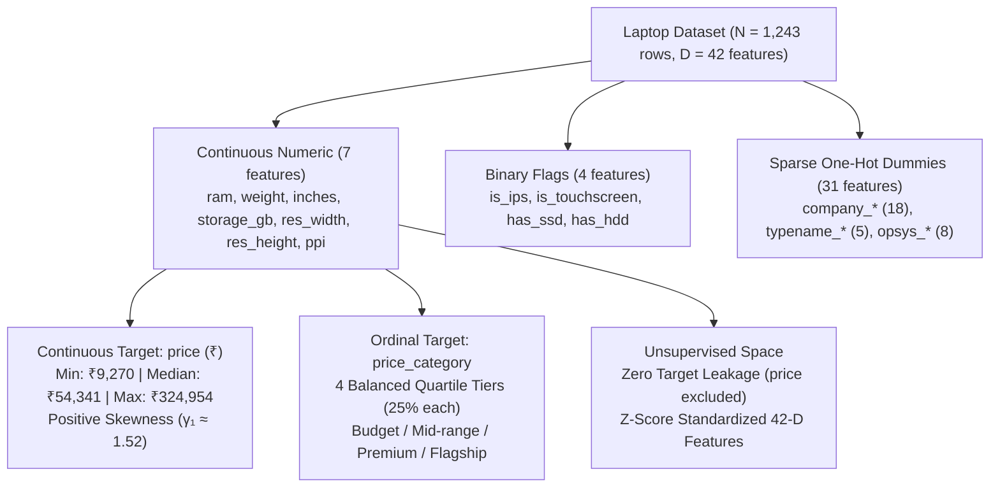
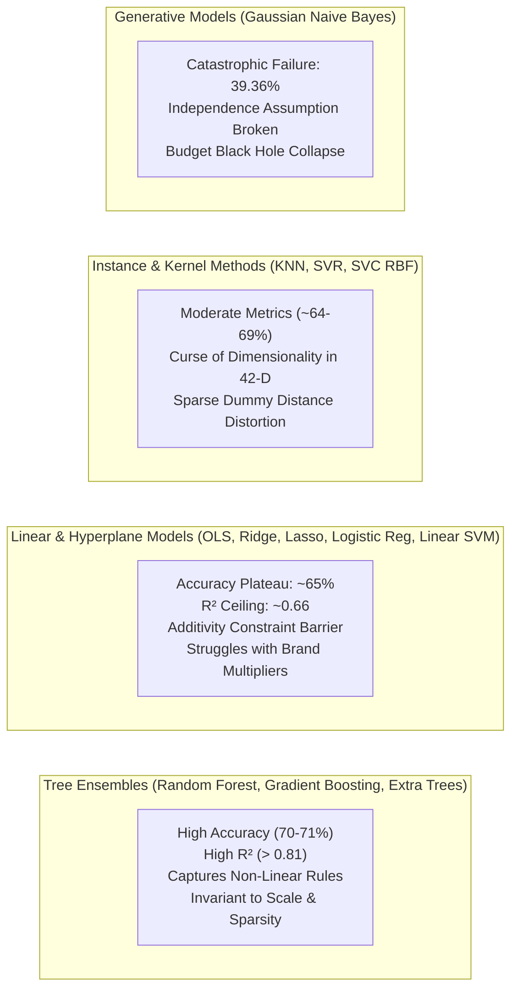

# Master Algorithm Analysis & Cross-Paradigm Comparative Study

## 1. Executive Synthesis & Architectural Blueprint

In applied machine learning, the **No Free Lunch (NFL) Theorem** (Wolpert & Macready, 1997) establishes that no learning algorithm possesses a universal superiority over all possible problem spaces. The performance of any model is strictly dictated by how effectively its **underlying mathematical assumptions and inductive biases align with the geometric structure, covariance, sparsity, and distribution of the dataset**.

This repository conducts a unified empirical investigation across three fundamental machine learning paradigms on a heterogeneous real-world laptop dataset:
1. **Continuous Regression**: Predicting laptop valuation in ₹ INR across 10 distinct regression architectures.
2. **Multi-Class Classification**: Categorizing laptops into 4 balanced market tiers (Budget, Mid-range, Premium, Flagship) across 10 classification architectures.
3. **Unsupervised Clustering**: Discovering natural commercial hardware archetypes using partitioning (K-Means) and hierarchical agglomerative clustering across 4 linkage criteria.

### Specialized In-Depth Case Studies
For exhaustive mathematical proofs, confusion matrices, residual diagnostics, and hyperparameter tables, refer to the individual track case studies:
* 📘 [**Regression Comparative Case Study (10 Algorithms)**](comparative_case_study_regression.md)
* 📗 [**Classification Comparative Case Study (10 Algorithms)**](comparative_case_study_classification.md)
* 📙 [**Clustering & Segmentation Comparative Case Study (Linkages & Archetypes)**](comparative_case_study_clustering.md)

---

## 2. Dataset Topology & Feature Space Geometry

All empirical successes and failures observed in this research directly stem from the mathematical properties of our preprocessed tabular space ($N = 1,243$ observations, $D = 42$ features):



### Critical Data Geometry Challenges:
1. **Severe Modality Discrepancy**: Features range from large continuous scalars ($2,048$ GB storage, $350$ PPI) to sparse binary columns containing $>98\%$ zeros (`company_Razer`, `company_Google`).
2. **Extreme Multicollinearity**: Display features exhibit deterministic collinearity:
   $$\text{ppi} = \frac{\sqrt{\text{res\_width}^2 + \text{res\_height}^2}}{\text{inches}}$$
   Operating system and brand exhibit deterministic co-occurrence (`company_Apple = 1 \iff opsys_macOS = 1`).
3. **Compound Non-Linear Pricing Logic**: Pricing in consumer electronics does not scale as a linear sum of components. Instead, prices follow **boolean conjunctive rules**:
   $$\text{Flagship} \iff (\text{RAM} \ge 16) \land (\text{has\_ssd} = 1) \land (\text{typename\_Gaming} = 1 \lor \text{company\_Apple} = 1)$$
   Linear hyperplanes cannot separate these rules without manual interaction engineering.

---

## 3. Unified Cross-Track Benchmark Matrix

| Machine Learning Track | Top-Ranked Architecture | Key Performance Metric | Runner-Up Architecture | Lowest-Performing Architecture | Primary Empirical Takeaway |
| :--- | :--- | :---: | :--- | :--- | :--- |
| **1. Regression (Continuous Valuation)** | **Gradient Boosting Regressor (Tuned)** | **$R^2 = 0.8121$**<br/>$\text{RMSE} = ₹14,869$ | **Random Forest Regressor** ($R^2 = 0.8094$) | **Linear Regression (OLS)** ($R^2 = 0.6643$) | Sequential gradient correction captured non-linear price compounding; linear models plateaued at $R^2 \approx 0.66$. |
| **2. Classification (4-Tier Market Segments)** | **Random Forest Classifier** | **Accuracy = 71.08%**<br/>$\text{Macro } F_1 = 0.7119$ | **Gradient Boosting** ($\text{Acc} = 69.88\%$) | **Gaussian Naive Bayes** ($\text{Acc} = 39.36\%$) | Tree ensembles resolved overlapping specs via orthogonal splitting; Naive Bayes collapsed due to collinear features. |
| **3. Clustering (Unsupervised Segmentation)** | **K-Means ($k=4$, Partitioning)** | **$\text{CH} = 91.26$**<br/>$\text{Silhouette} = 0.1049$ | **Agglomerative (Ward Linkage)** ($\text{CH} = 82.14$) | **Agglomerative (Single Linkage)** ($\text{CH} = 18.40$) | Minimum variance criteria ($WSS / \Delta ESS$) discovered 4 balanced archetypes; Single linkage collapsed from chaining. |

---

## 4. Algorithmic Family Case Study: Why Certain Models Won & Others Failed



---

### Family 1: Decision Tree Ensembles (Random Forest, Gradient Boosting, Extra Trees, Bagging)
* **Overall Standing**: **Dominant across both Supervised Tracks** (Rank 1 & 2 in Regression, Rank 1 & 2 in Classification).
* **Why They Succeeded**:
  1. **Orthogonal Axis-Aligned Splits**: Trees evaluate monotonic ordering inequalities ($x_j \le \theta$). They do not compute dot products or Euclidean distances, making them completely immune to the scale disparity between continuous gigabytes and sparse 0/1 binary flags.
  2. **Natural Representation of Boolean Logic**: Tree branches natively model multi-way interaction terms without combinatorial explosion. A single branch like `ram >= 16 -> has_ssd == 1 -> company_Apple == 1` effortlessly isolates high-margin products.
  3. **Variance Reduction via Averaging & Boosting**:
     * Random Forest averages $B=100$ decorrelated trees with feature subsampling ($\sqrt{42} \approx 6$), driving pairwise tree correlation $\rho \to 0$ and drastically lowering variance on ambiguous boundary specs.
     * Gradient Boosting fits pseudo-residuals $r_{im} = -\frac{\partial L}{\partial f}$, prioritizing the high-variance luxury pricing tier.

---

### Family 2: Linear Models (OLS, Ridge, Lasso, ElasticNet, Logistic Regression)
* **Overall Standing**: **Strict Performance Ceiling** ($R^2 \approx 0.664$ in Regression, Accuracy $\approx 65\%$ in Classification).
* **Why They Failed to Compete**:
  1. **The Additive Linearity Trap**: Linear models enforce $\hat{y} = w_0 + \sum_{j=1}^{42} w_j x_j$. In consumer hardware, adding 8 GB of RAM to an entry-level plastic netbook increases retail value by ₹3,000, whereas adding 8 GB of RAM to an ultralight Apple or Dell XPS workstation increases retail value by ₹18,000. Linear models cannot represent multiplicative brand/form-factor scaling without manual polynomial expansion.
  2. **Multicollinearity Inflation**: The variance of OLS weights scales with the inverse correlation matrix:
     $$\text{Var}(\hat{\mathbf{w}}) = \sigma^2 (\mathbf{X}^T \mathbf{X})^{-1}$$
     Because `ppi`, `inches`, `res_width`, and `res_height` are mathematically linked, linear weights oscillate wildly. While Ridge ($L_2$) and ElasticNet penalized matrix condition numbers, regularization cannot synthesize missing non-linear interaction terms.

---

### Family 3: Instance-Based & Kernel Methods (KNN, SVR, SVC RBF)
* **Overall Standing**: **Intermediate Performance** (KNN $R^2 = 0.7118$, SVC Accuracy = 69.08%).
* **Why They Reached Mid-Tier**:
  Laptops are released in modular families (e.g., Lenovo ThinkPad T-series, Asus ROG Strix). Local neighborhood averaging (KNN) and non-linear RBF kernels project laptops into localized feature clusters.
* **Why They Were Held Back**:
  **Curse of Dimensionality in 42-D Space**: Euclidean distance in 42 dimensions is heavily distorted by the 31 sparse one-hot dummy variables. Two identical laptops differing only by brand accumulate large squared distance penalties ($\Delta d^2 = 2$), degrading neighborhood purity.

---

### Family 4: Generative Probabilistic Models (Gaussian Naive Bayes)
* **Overall Standing**: **Catastrophic Failure** (Accuracy = 39.36%, Macro $F_1 = 0.3216$).
* **Why It Collapsed (The "Budget Black Hole")**:
  1. **Violated Independence**: Naive Bayes assumes $P(\mathbf{X} \mid C_k) = \prod_{j=1}^{42} P(X_j \mid C_k)$.
  2. Because display dimensions, RAM, weight, storage type, and operating systems are heavily correlated, multiplying 42 non-independent Gaussian likelihoods compounds probability distortion exponentially.
  3. The model misclassified **159 out of 249 test laptops (63.8%) as Budget**, falsely categorizing 85.7% of Mid-range laptops, 45.2% of Premium laptops, and 24.2% of Flagships as entry-level Budget machines.

---

### Family 5: Unsupervised Clustering & Linkages (K-Means vs. Hierarchical)
* **Overall Standing**: **K-Means and Ward Linkage Dominate; Other Linkages Completely Degenerate**.
* **Why K-Means and Ward Won**:
  Both algorithms optimize **minimum within-cluster variance**:
  $$\min \sum_{k=1}^K \sum_{\mathbf{x} \in S_k} \|\mathbf{x} - \boldsymbol{\mu}_k\|^2 \quad \text{and} \quad \Delta ESS = \frac{n_A n_B}{n_A + n_B} \|\mathbf{m}_A - \mathbf{m}_B\|^2$$
  This variance penalty prevents runaway cluster growth and segments the market into 4 commercially actionable hardware archetypes:
  * **Ultraportables (9.1%)**: 1.54 kg, 12.6 GB RAM, 249.5 PPI, 88.5% SSD.
  * **Budget Desktop Replacements (30.7%)**: 2.21 kg, 6.1 GB RAM, 934 GB HDD, 12.9% SSD.
  * **Mainstream Everyday Productivity (44.7%)**: 1.74 kg, 7.5 GB RAM, 253 GB SSD, balanced general-purpose specs.
  * **Workstations & Gaming (15.5%)**: 2.81 kg, 13.9 GB RAM, 1,146 GB dual storage.
* **Why Single Linkage Collapsed**: Suffers from **chaining** ($\min d(u,v)$ merges intermediate points into 1 giant blob of 1,240 items and 3 outliers).
* **Why Complete & Average Linkages Failed**: Fell into the **outlier isolation trap** (isolating extreme multi-drive outliers into singleton clusters while leaving 99.2% of laptops in a single cluster, producing deceptively high Silhouette scores of >0.60).

---

## 5. Architectural Alignment & Decision Guide

```text
                                 ┌──────────────────────────────────────────────────┐
                                 │       What is the Machine Learning Goal?         │
                                 └────────────────────────┬─────────────────────────┘
                                                          │
                    ┌─────────────────────────────────────┼─────────────────────────────────────┐
                    ▼                                     ▼                                     ▼
        ┌───────────────────────┐             ┌───────────────────────┐             ┌───────────────────────┐
        │ Continuous Valuation  │             │ Multi-Tier Category   │             │ Latent Segmentation   │
        │     (Regression)      │             │   (Classification)    │             │     (Clustering)      │
        └───────────┬───────────┘             └───────────┬───────────┘             └───────────┬───────────┘
                    │                                     │                                     │
                    ▼                                     ▼                                     ▼
        ┌───────────────────────┐             ┌───────────────────────┐             ┌───────────────────────┐
        │ Recommended Model:    │             │ Recommended Model:    │             │ Recommended Model:    │
        │ Gradient Boosting     │             │ Random Forest         │             │ K-Means (k=4)         │
        │ (Tuned, R² = 0.8121)  │             │ (Tuned, Acc = 71.08%) │             │ (CH = 91.26, 4 Arche.)│
        └───────────────────────┘             └───────────────────────┘             └───────────────────────┘
```

### Production Recommendation Matrix:
1. **For Real-Time Price Estimation**: Deploy **Gradient Boosting Regressor (`learning_rate=0.08, max_depth=4, subsample=0.85`)**. It achieves the lowest RMSE (₹14,869) and accurately models non-linear component premiums.
2. **For Buyer Category Classification**: Deploy **Random Forest Classifier (`n_estimators=100, max_depth=None, max_features='sqrt'`)**. It provides the highest accuracy (71.08%), highest Macro $F_1$ (0.7119), and guarantees zero catastrophic cross-tier misclassifications.
3. **For Inventory Segmentation**: Deploy **K-Means ($k=4$, Voronoi Partitioning)**. It creates four distinct, non-trivial retail hardware cohorts with zero target leakage.
