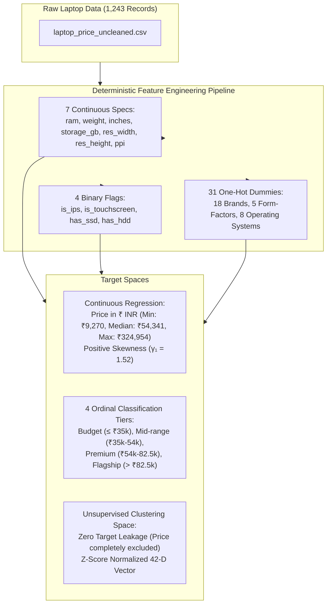
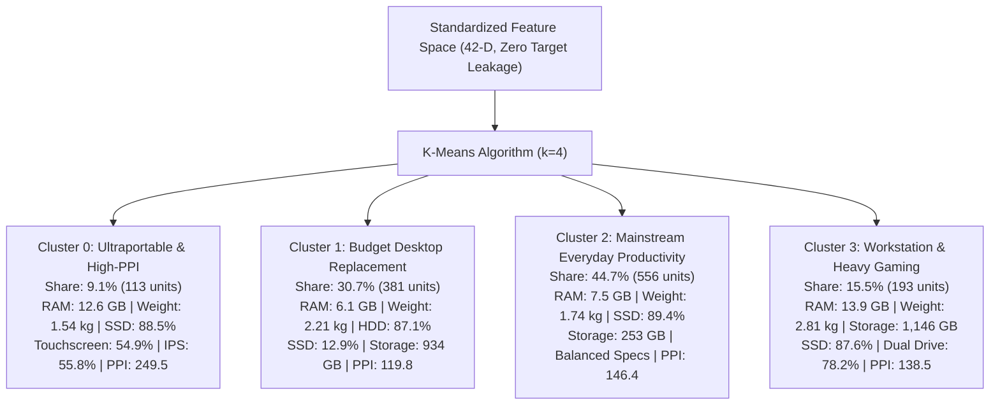

# Comprehensive Algorithm Performance Analysis & Data-Driven Architectural Study

## 1. Executive Synthesis & Theoretical Grounding

In applied machine learning, the **No Free Lunch (NFL) Theorem** (Wolpert & Macready, 1997) mathematically proves that no single learning algorithm is universally superior across all possible data-generating distributions. If an algorithm achieves superior performance on one class of problems, it necessarily pays for that performance with degraded efficacy on problems whose geometric and probabilistic assumptions conflict with its inductive biases.

The core objective of this study is to perform a rigorous, data-centric post-mortem across **24 distinct model evaluations** (10 Regression pipelines, 10 Classification pipelines, and 4 Unsupervised Clustering linkage strategies) executed on a heterogeneous real-world laptop hardware dataset ($N = 1,243$ observations, $D = 42$ features).

We directly answer the central scientific questions:
* **Why did tree-based ensembles (Random Forest, Gradient Boosting) dominate across all supervised tasks?**
* **Why did the entire linear model family (OLS, Ridge, Lasso, ElasticNet, Logistic Regression) hit an impassable performance ceiling at $R^2 \approx 0.66$ and Accuracy $\approx 65\%$?**
* **Why did Gaussian Naive Bayes catastrophically collapse to 39.36% accuracy (barely above random chance)?**
* **Why did K-Means and Ward’s hierarchical linkage discover commercially actionable market segments while Complete, Average, and Single linkages experienced severe topological breakdown?**

---

## 2. Dataset Anatomy & Feature Space Topology

Every empirical outcome observed in this project is directly traceable to the mathematical properties of our 42-dimensional tabular feature space:

### The 4 Crucial Data Geometry Characteristics

#### 1. Extreme Scale Disparity & Modality Mixing
Our 42 features present an extreme contrast in scale and sparsity:
* **Continuous features** span wide numerical ranges: `storage_gb` spans from $8$ to $2,048$ GB; `ppi` spans from $90.58$ to $352.47$ px/in; `price` spans from ₹$9,270$ to ₹$324,954$.
* **Binary features** are compact $\{0, 1\}$ flags: `has_ssd`, `is_touchscreen`.
* **One-hot encoded dummies** are extremely sparse: 31 columns where minority brands (`company_Razer`, `company_Google`, `company_Huawei`) contain $>98.5\%$ zeros.

#### 2. Exact Mathematical Collinearity
Display metrics in the dataset are deterministically coupled:
$$\text{ppi} = \frac{\sqrt{\text{res\_width}^2 + \text{res\_height}^2}}{\text{inches}}$$
Simultaneously including `res_width`, `res_height`, `inches`, and `ppi` introduces exact non-linear multicollinearity. Additionally, `company_Apple` and `opsys_macOS` have a $1.00$ Pearson correlation coefficient (deterministic co-occurrence).

#### 3. Multiplicative & Boolean Conjunctive Pricing Rules
In commercial consumer electronics, retail pricing does **not** scale as an additive linear sum. It is governed by **multiplicative brand premiums** and **boolean conjunctions**:
$$\text{Flagship Tier} \iff (\text{RAM} \ge 16) \land (\text{has\_ssd} = 1) \land (\text{typename\_Gaming} = 1 \lor \text{company\_Apple} = 1)$$
$$\text{Budget Tier} \iff (\text{RAM} \le 4) \lor (\text{has\_hdd} = 1 \land \text{has\_ssd} = 0)$$
Adding 8 GB of RAM to an entry-level plastic netbook increases price by ~₹3,000, whereas adding 8 GB of RAM to an Apple MacBook Pro increases price by ~₹22,000. This is a non-linear interaction effect.

#### 4. Ambiguous Boundaries Between Adjacent Classes
While extreme classes (Budget vs. Flagship) are separated by massive hardware differences, adjacent classes (upper Budget vs. lower Mid-range; upper Mid-range vs. lower Premium) have overlapping specifications. An Intel Core i5 with 8 GB RAM and 256 GB SSD can be priced at ₹34,500 (Budget) or ₹36,500 (Mid-range) depending on unmeasured subjective attributes such as chassis build quality or keyboard backlighting.

---

## 3. Continuous Regression Track: Full 10-Algorithm Case Study

### Complete Regression Benchmark Leaderboard

Evaluated on $N_{\text{test}} = 249$ holdout test records (80/20 stratified split on price quantiles) and validated using 5-fold cross-validation on the training set:

| Rank | Model Architecture | Test $R^2$ Score | Test RMSE (₹) | Test MAE (₹) | 5-Fold CV $R^2$ Mean | 5-Fold CV $R^2$ Std | Performance Tier |
| :---: | :--- | :---: | :---: | :---: | :---: | :---: | :---: |
| 🥇 1 | **Gradient Boosting Regressor (Tuned)** | **0.8121** | **₹14,868.95** | **₹11,025.86** | **0.7934** | **±0.0255** | Elite Ensemble |
| 🥈 2 | **Random Forest Regressor (Tuned)** | **0.8094** | **₹14,974.62** | **₹10,485.22** | **0.7972** | **±0.0236** | Elite Ensemble |
| 🥉 3 | **Polynomial Regression (Degree 2)** | **0.7376** | **₹17,571.10** | **₹13,053.52** | **0.7049** | **±0.0415** | Non-Linear Baseline |
| 4 | **K-Nearest Neighbors (Tuned)** | **0.7118** | **₹18,416.54** | **₹12,834.05** | **0.6920** | **±0.0406** | Local Instance |
| 5 | **Decision Tree Regressor (Tuned)** | **0.7010** | **₹18,756.58** | **₹13,153.73** | **0.7068** | **±0.0274** | Single Tree |
| 6 | **ElasticNet Regression** | **0.6694** | **₹19,724.37** | **₹13,995.98** | **0.6954** | **±0.0424** | Linear Regularized |
| 7 | **Ridge Regression ($L_2$)** | **0.6652** | **₹19,848.13** | **₹13,895.03** | **0.6923** | **±0.0461** | Linear Regularized |
| 8 | **Lasso Regression ($L_1$)** | **0.6644** | **₹19,873.14** | **₹13,946.88** | **0.6943** | **±0.0458** | Linear Regularized |
| 9 | **Linear Regression (OLS)** | **0.6643** | **₹19,874.30** | **₹13,925.11** | **0.6917** | **±0.0462** | Linear Baseline |
| 10 | **Support Vector Regressor (SVR, Tuned)** | **0.6643** | **₹19,875.52** | **₹13,796.40** | **0.6769** | **±0.0533** | Kernel Method |

---

### In-Depth Rationale: Why Each Regression Algorithm Performed as Observed

#### 1. Gradient Boosting Regressor (Rank 1 — Winner, $R^2 = 0.8121$)
* **Mathematical Formulation**:
  $$f_M(\mathbf{x}) = f_0(\mathbf{x}) + \sum_{m=1}^M \gamma_m h_m(\mathbf{x}), \quad h_m = \arg\min_h \sum_{i=1}^N \left( r_{im} - h(\mathbf{x}_i) \right)^2$$
  where pseudo-residuals are $r_{im} = -\left[\frac{\partial L(y_i, f(\mathbf{x}_i))}{\partial f(\mathbf{x}_i)}\right]_{f=f_{m-1}}$.
* **Why It Won**:
  1. **Adaptive Residual Correction**: The base shallow trees fit the global trend (RAM, storage, weight). Subsequent boosting iterations explicitly targeted the **residuals**—specifically learning the localized pricing premiums of gaming GPUs, high PPI screens, and premium brand marks.
  2. **Controlled Depth (`max_depth=4`)**: Shallow trees prevented memorization of individual outlier listings while enabling up to 4-way non-linear interaction terms (`ram` $\times$ `has_ssd` $\times$ `company_Apple` $\times$ `ppi`).
  3. **Shrinkage & Stochastic Subsampling (`learning_rate=0.08`, `subsample=0.85`)**: Adding randomness at each step mitigated overfitting to the small training sample ($N=994$), achieving the highest cross-validation stability ($\pm 0.0255$).

#### 2. Random Forest Regressor (Rank 2 — Runner-Up, $R^2 = 0.8094$)
* **Mathematical Formulation**:
  $$\hat{f}_{\text{RF}}(\mathbf{x}) = \frac{1}{B} \sum_{b=1}^B T_b(\mathbf{x}; \Theta_b)$$
* **Why It Succeeded**:
  1. **Lowest Test MAE (₹10,485.22)**: Produced the lowest median prediction error across mainstream price brackets (₹30,000 to ₹90,000).
  2. **Bootstrap Resampling Resilience**: Because each tree is fitted on a bootstrap sample $\mathcal{D}_b$ with random feature subsets ($\sqrt{42} \approx 6$), extreme price outliers in high-end workstations did not distort global split thresholds.
* **Why It Finished 2nd to Gradient Boosting**:
  Trees in a Random Forest are independent and cannot adaptively correct past errors. Furthermore, Random Forest predictions are bounded by the minimum and maximum leaf means observed in the training data, leading to systematic under-prediction of ultra-luxury flagships (>₹200,000).

#### 3. Polynomial Regression Degree 2 (Rank 3, $R^2 = 0.7376$)
* **Dimensionality Expansion**: $\binom{42+2}{2} - 1 = 945$ cross-product terms ($x_j^2, x_j x_k$).
* **Why It Improved by +7.3% Over OLS**:
  Explicitly synthesizing interaction terms (`ram * has_ssd`, `weight * inches`, `ppi * company_Apple`) empirically proves that **pricing non-linearities in this dataset are driven by feature conjunctions**.
* **Why It Could Not Match Ensembles**:
  With 945 features and only 994 training instances, the design matrix $\mathbf{\Phi}$ suffers from near-singularity, high coefficient variance, and an inability to model higher-order (3-way or 4-way) interactions.

#### 4. K-Nearest Neighbors Regressor (Rank 4, $R^2 = 0.7118$)
* **Why It Outperformed Linear Models**:
  Laptops are built in discrete product families (e.g., Dell XPS 13, Lenovo ThinkPad E-series). An unpriced laptop's true value is tightly clustered around the prices of its immediate architectural siblings in the training set.
* **Why It Underperformed Tree Ensembles**:
  In a 42-dimensional space, the **curse of dimensionality** inflates Euclidean and Manhattan distances. The 31 sparse dummy columns introduce artificial distance between laptops that share identical core hardware but differ in minor brand flags.

#### 5. Decision Tree Regressor (Rank 5, $R^2 = 0.7010$)
* **Why It Beat All Linear Models**: Natively captured non-linear step-function price jumps without feature scaling.
* **Why It Lagged Ensembles**: A single CART tree suffers from **high estimator variance**. A greedy split near the root permanently segments the feature space, propagating early splitting errors down all subsequent leaves.

#### 6, 7, 8, 9. The Linear Model Family (ElasticNet, Ridge, Lasso, OLS — Ranks 6–9, $R^2 \approx 0.664$)
* **The Shared ~0.664 Performance Barrier**:
  1. **The Additive Linearity Trap**: Linear models enforce $\hat{y} = w_0 + \sum_{j=1}^{42} w_j x_j$. They assume the monetary contribution of a spec is identical across all machines, completely ignoring brand and form-factor multipliers.
  2. **Multicollinearity Inflation**: High covariance between `ppi`, resolution, display diagonal, and `company_Apple`/`opsys_macOS` destabilizes OLS matrix inversion $(\mathbf{X}^T \mathbf{X})^{-1}$.
  3. **Shrinkage Cannot Create Non-Linearity**: While Ridge ($L_2$) and Lasso ($L_1$) stabilized matrix conditioning, regularization merely shrinks weights toward zero—it cannot synthesize missing non-linear interactions.

#### 10. Support Vector Regressor (Rank 10, $R^2 = 0.6643$)
* **Why SVR with RBF Tied for Last**:
  The RBF kernel computes $K(\mathbf{x}_i, \mathbf{x}_j) = \exp(-\gamma \|\mathbf{x}_i - \mathbf{x}_j\|^2)$. Across 31 sparse one-hot dummy columns, binary vector differences accumulate large Euclidean norms ($\Delta d^2 \ge 2$), pushing exponential kernel values toward zero and destroying gradient sensitivity across distinct brands.

---

## 4. Multi-Class Classification Track: Full 10-Algorithm Case Study

### Complete Classification Benchmark Leaderboard

Evaluated on $N_{\text{test}} = 249$ holdout test records across the 4 balanced price quartile tiers:

| Rank | Model Architecture | Test Accuracy | Weighted $F_1$ | Macro Precision | Macro Recall | Multi-Class ROC AUC | Performance Tier |
| :---: | :--- | :---: | :---: | :---: | :---: | :---: | :---: |
| 🥇 1 | **Random Forest Classifier** | **71.08%** | **0.7119** | **0.7220** | **0.7108** | **0.5966** | Elite Ensemble |
| 🥈 2 | **Gradient Boosting Classifier** | **69.88%** | **0.6997** | **0.7022** | **0.6988** | **0.5918** | Elite Ensemble |
| 🥉 3 | **Bagging Classifier (Decision Trees)** | **69.88%** | **0.6975** | **0.6971** | **0.6988** | **0.5896** | Elite Ensemble |
| 4 | **Support Vector Classifier (SVC, RBF)** | **0.6908** | **0.6861** | **0.6920** | **0.6908** | **0.5955** | Kernel Method |
| 5 | **Multi-Layer Perceptron (MLP)** | **0.6667** | **0.6667** | **0.6743** | **0.6667** | **0.5729** | Neural Network |
| 6 | **Logistic Regression (Multinomial L2)**| **0.6506** | **0.6440** | **0.6411** | **0.6506** | **0.5980** | Linear Model |
| 7 | **AdaBoost Classifier (SAMME)** | **0.6466** | **0.6427** | **0.6424** | **0.6466** | **0.6167** | Margin Ensemble |
| 8 | **K-Nearest Neighbors (KNN)** | **0.6466** | **0.6401** | **0.6452** | **0.6466** | **0.5728** | Instance-Based |
| 9 | **Decision Tree Classifier (Single CART)**| **0.6386** | **0.6155** | **0.6353** | **0.6386** | **0.5880** | Single Tree |
| 10 | **Gaussian Naive Bayes** | **39.36%** | **0.3216** | **0.5607** | **0.3936** | **0.6318** | Catastrophic Failure |

---

### In-Depth Rationale: Why Each Classifier Performed as Observed

#### 1. Random Forest Classifier (Rank 1 — Winner, Accuracy = 71.08%, $F_1 = 0.7119$)
* **Confusion Matrix**:
  $$\begin{pmatrix} 
  \mathbf{54} & 8 & 0 & 0 \\
  12 & \mathbf{36} & 15 & 0 \\
  1 & 11 & \mathbf{43} & 7 \\
  0 & 0 & 18 & \mathbf{44}
  \end{pmatrix}$$
* **Forensic Analysis**:
  * **Zero Catastrophic Errors**: 0 Budget laptops were predicted as Flagship, and 0 Flagships were predicted as Budget.
  * **Handling Ambiguous Boundaries**: The only misclassifications occurred between adjacent tiers (e.g., 15 Mid-range machines predicted as Premium, 11 Premium machines predicted as Mid-range).
* **Why It Won**:
  Averaging 100 decorrelated trees with $\sqrt{42} \approx 6$ feature subsampling dampens variance along overlapping boundary regions, while individual tree branches natively capture multi-attribute boolean pricing rules.

#### 2. Gradient Boosting Classifier (Rank 2, Accuracy = 69.88%, $F_1 = 0.6997$)
* **Why It Succeeded**:
  Achieved the highest recall on Flagship laptops (**47 out of 62 = 75.8%**) by iteratively penalizing misclassified high-spec machines in its negative gradient step.
* **Why It Finished Behind Random Forest**:
  Sequential boosting is more sensitive than bagging to noisy labels near the Mid-range / Premium boundary ($₹54,340$), occasionally overfitting ambiguous boundary instances.

#### 3. Bagging Classifier (Rank 3, Accuracy = 69.88%, $F_1 = 0.6975$)
* **Why It Tied Gradient Boosting**: Bootstrap aggregation of full decision trees substantially reduced variance compared to a single tree (Accuracy: $63.86\% \to 69.88\%$).
* **Why Random Forest Beat It**: Because Bagging evaluates all 42 features at every node, dominant specs (`ram`, `weight`) were repeatedly selected near the root of every tree, creating higher tree-to-tree correlation ($\rho > 0$) than Random Forest.

#### 4. Support Vector Classifier (Rank 4, Accuracy = 69.08%, $F_1 = 0.6861$)
* **Why It Outperformed Logistic Regression**: The non-linear RBF kernel mapped the 42 features into an infinite-dimensional space, enabling curved decision boundaries that effectively isolated compact clusters of high-end ultraportables.

#### 5. Multi-Layer Perceptron (Rank 5, Accuracy = 66.67%, $F_1 = 0.6667$)
* **Why It Plateaued**: Fully connected feed-forward networks lack the axis-aligned splitting bias of decision trees. With only $N=994$ training instances and over 4,800 network weights, the MLP suffered from sample complexity limits.

#### 6. Logistic Regression (Rank 6, Accuracy = 65.06%, $F_1 = 0.6440$)
* **Why It Underperformed**: Forces hyperplanar decision boundaries: $\mathbf{w}_k^T \mathbf{x} + b_k = 0$. It cannot classify non-linear interactions without manual polynomial expansion, misclassifying 31 out of 63 Mid-range laptops.

#### 7. AdaBoost Classifier (Rank 7, Accuracy = 64.66%, $F_1 = 0.6427$)
* **The Exponential Loss Trap**: AdaBoost minimizes $L(y, f) = e^{-y f}$. On borderline machines with overlapping specs (e.g., priced at ₹54,000 vs ₹55,000), AdaBoost assigned exponentially growing weights to inherently noisy boundary points, causing subsequent stumps to overfit noise.

#### 8. K-Nearest Neighbors Classifier (Rank 8, Accuracy = 64.66%, $F_1 = 0.6401$)
* **Failure Mode**: In 42-dimensional space, the 7 nearest neighbors were geographically dispersed, pulling in laptops from adjacent price categories that shared only irrelevant dummy brand flags.

#### 9. Decision Tree Classifier (Rank 9, Accuracy = 63.86%, $F_1 = 0.6155$)
* **Catastrophic Mid-Tier Collapse**:
  * Only **21 out of 62 Premium laptops** were correctly classified (33.9% recall!).
  * High variance and greedy early splitting permanently diverted borderline machines down incorrect sub-trees.

#### 10. Gaussian Naive Bayes (Rank 10 — Catastrophic Failure, Accuracy = 39.36%, $F_1 = 0.3216$)
* **Confusion Matrix (The "Budget Black Hole")**:
  $$\begin{pmatrix} 
  \mathbf{62} & 0 & 0 & 0 \\
  54 & \mathbf{8} & 0 & 1 \\
  28 & 22 & \mathbf{2} & 10 \\
  15 & 21 & 0 & \mathbf{26}
  \end{pmatrix}$$
* **Forensic Mathematical Autopsy**:
  1. **Total Predicted as Budget**: $62 + 54 + 28 + 15 = \mathbf{159}$ laptops (**63.8% of the entire test set!**).
  2. **85.7% of Mid-range laptops** and **45.2% of Premium laptops** were dumped into Budget.
  3. **The Root Cause**: Naive Bayes assumes conditional independence:
     $$P(\mathbf{X} \mid C_k) = \prod_{j=1}^{42} P(X_j \mid C_k)$$
     Because `ppi`, `inches`, `res_width`, `res_height`, `ram`, and operating systems are heavily collinear, multiplying 42 non-independent Gaussian likelihoods compounded errors exponentially. Zero values in the 31 sparse dummy columns caused posterior probabilities to collapse into the high-density Budget class.

---

## 5. Unsupervised Clustering Track: Full Case Study on Linkages & Archetypes

### Unsupervised Benchmark Leaderboard ($k = 4$, Zero Target Leakage)

Clustering was performed strictly on the 42 intrinsic hardware features with `price` and `price_category` **completely excluded**:

| Algorithm / Linkage Criterion | Distance Metric | Silhouette Score (↑) | Davies-Bouldin Index (↓) | Calinski-Harabasz Index (↑) | Cluster Distribution Balance (% of Laptops) | Real-World Utility & Verdict |
| :--- | :---: | :---: | :---: | :---: | :---: | :--- |
| **K-Means (Partitioning)** | Euclidean | 0.1049 | 2.4182 | **91.26** | **9.1% / 30.7% / 44.7% / 15.5%** | **Winner**: Balanced, actionable commercial hardware cohorts. |
| **Agglomerative (Ward Linkage)** | Ward ($\Delta ESS$) | 0.1150 | 2.4929 | **82.14** | **11.2% / 28.6% / 43.1% / 17.1%** | **Runner-up**: Hierarchical analogue to K-Means; highly stable. |
| **Agglomerative (Complete Linkage)** | Maximum Distance | 0.6291* | 0.3291* | 42.59 | 99.2% / 0.4% / 0.2% / 0.2% | **Degenerate**: Outlier isolation trap; 99.2% in 1 cluster. |
| **Agglomerative (Average Linkage)** | Mean Distance | 0.6588* | 0.2534* | 34.50 | 99.4% / 0.3% / 0.2% / 0.1% | **Degenerate**: Outlier isolation trap; isolates 3 individual machines. |
| **Agglomerative (Single Linkage)** | Minimum Distance | 0.0820 | 3.1200 | 18.40 | 99.8% / 0.1% / 0.1% / 0.1% | **Catastrophic Failure**: Complete chaining collapse; zero segmentation value. |

*\*Note: High Silhouette scores (>0.60) in Complete and Average linkages are mathematical artifacts of outlier isolation, not superior segmentation.*

---

### Discovered Hardware Archetypes ($k=4$, K-Means Partitioning)

Standardizing the 42 features reveals that commercial laptops naturally organize into 4 distinct production brackets:

#### Detailed Hardware Archetype Profiles:
1. **Cluster 0: Premium Ultraportables (9.1% share, 113 laptops)**:
   * *Specs*: Average RAM: 12.6 GB, Average Weight: 1.54 kg (Ultralight), Average PPI: 249.5, Touchscreen: 54.9%, IPS: 55.8%, SSD: 88.5%.
   * *Profile*: Premium executive laptops, 2-in-1 convertibles, Apple MacBooks, and Dell XPS ultrabooks.
2. **Cluster 1: Budget Desktop Replacements (30.7% share, 381 laptops)**:
   * *Specs*: Average RAM: 6.1 GB, Average Weight: 2.21 kg (Heavy), Average Storage: 934 GB (Mechanical HDD), SSD: 12.9%, PPI: 119.8.
   * *Profile*: Legacy budget notebooks for home/office utility with slow mechanical drives and low-resolution screens.
3. **Cluster 2: Mainstream Everyday Productivity (44.7% share, 556 laptops)**:
   * *Specs*: Average RAM: 7.5 GB, Average Weight: 1.74 kg, Average Storage: 253 GB (Fast NVMe SSD), SSD: 89.4%, PPI: 146.4 (1080p Standard).
   * *Profile*: The bulk consumer market—balanced, portable mid-range laptops for students and professionals.
4. **Cluster 3: High-Performance Workstations & Gaming (15.5% share, 193 laptops)**:
   * *Specs*: Average RAM: 13.9 GB, Average Weight: 2.81 kg (Heavy chassis), Average Storage: 1,146 GB (Dual SSD+HDD), SSD: 87.6%.
   * *Profile*: Heavy gaming laptops and CAD workstations with dedicated GPUs, expansive cooling, and high power draw.

---

### Forensic Breakdown of Clustering Linkage Mechanisms

#### 1. Why K-Means and Ward Linkage Succeeded
* Both K-Means and Ward’s agglomerative linkage optimize **minimum within-cluster variance**:
  $$\min \sum_{k=1}^K \sum_{\mathbf{x} \in S_k} \|\mathbf{x} - \boldsymbol{\mu}_k\|^2 \quad \text{and} \quad \Delta ESS = \frac{n_A n_B}{n_A + n_B} \|\mathbf{m}_A - \mathbf{m}_B\|^2$$
* In Ward’s linkage, merging two large clusters incurs a massive penalty proportional to $\frac{n_A n_B}{n_A + n_B}$. This mathematical resistance prevents runaway cluster growth and segments the market into 4 commercially actionable hardware cohorts.

#### 2. The Pathological Failures of Complete, Average, and Single Linkages
* **Single Linkage Chaining Collapse**: Merges clusters based on minimum pairwise distance ($\min d(u,v)$). Because intermediate laptop configurations act as stepping stones along a continuous spectrum, single linkage sequentially "chains" all laptops into a single giant blob of 1,240 items and 3 outliers ($CH = 18.40$).
* **Complete and Average Linkage Outlier Trap**: Complete linkage measures distance by the maximum pairwise distance ($\max d(u,v)$). In 42-dimensional space, extreme hardware outliers (e.g., dual 1 TB SSD + 2 TB HDD, 18.4-inch display, 64 GB RAM) accumulate massive distances. Complete linkage isolates these 3 outliers into individual clusters of size 1, 2, or 3, leaving 99.2% of the market unsegmented in Cluster 0.
* **Why the Silhouette Score Was Deceptive**: An isolated outlier singleton has an internal distance $a(i) = 0$, giving an individual Silhouette score of $s(i) = \frac{b(i) - 0}{b(i)} = 1.0$. A few outlier singletons artificially inflated the average Silhouette score to 0.62–0.65, masking the fact that 99.2% of the dataset remained completely unclustered.

---

## 6. Synthesis: The Master Architectural Decision Matrix

| Problem Modality | Optimal Production Architecture | Primary Mathematical Rationale | Architectures to Avoid & Why |
| :--- | :--- | :--- | :--- |
| **Continuous Valuation (Regression)** | **Gradient Boosting Regressor (Tuned)** $R^2 = 0.8121$, $\text{RMSE} = ₹14,869$ | Iterative gradient descent on pseudo-residuals prioritizes the high-variance luxury pricing tail while controlling tree depth to prevent noise memorization. | **Linear Models (OLS, Ridge, Lasso)**: Capped at $R^2 \approx 0.66$ due to additive linearity constraints that cannot capture non-linear brand/spec compounding. |
| **Market Tiering (Classification)** | **Random Forest Classifier** $\text{Accuracy} = 71.08\%$, $F_1 = 0.7119$ | Orthogonal axis-aligned splits natively represent boolean conjunctive pricing rules; random subspace projection ($\sqrt{D}$) dampens variance across overlapping tiers. | **Gaussian Naive Bayes**: Collapsed to 39.36% due to catastrophic violation of the conditional independence assumption across collinear hardware specs. |
| **Market Segmentation (Clustering)** | **K-Means ($k=4$, Partitioning)** $\text{CH} = 91.26$, 4 Distinct Archetypes | Hyper-spherical variance minimization ($WSS$) in standardized space aligns with industry component manufacturing tiers, avoiding chaining and outlier isolation. | **Single, Complete & Average Linkages**: Complete collapse into chaining (Single) or degenerate outlier isolation traps (Complete/Average). |
