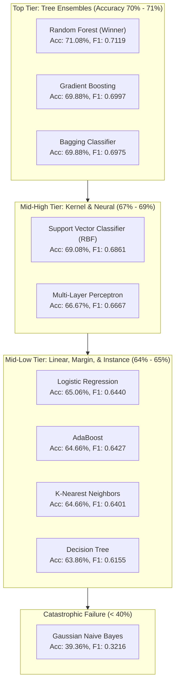

# Comparative Case Study: Classification Algorithms for Laptop Market Tiering

## 1. Problem Formulation & Classification Geometry

The classification objective is to categorize laptops into **4 ordinal market tiers** based on price quartiles calculated across the entire dataset:
* **Class 0 (Budget)**: Price ≤ Q1 (≤ ₹35,000) — Target share: 25% (62 test samples)
* **Class 1 (Mid-range)**: Q1 < Price ≤ Q2 (₹35,000 - ₹54,340) — Target share: 25% (63 test samples)
* **Class 2 (Premium)**: Q2 < Price ≤ Q3 (₹54,340 - ₹82,500) — Target share: 25% (62 test samples)
* **Class 3 (Flagship)**: Price > Q3 (> ₹82,500) — Target share: 25% (62 test samples)

### Feature Space Topology
* **Input Dimension**: D = 42 features (7 continuous, 4 binary flags, 31 sparse one-hot dummy variables).
* **Sample Count**: N_train = 994, N_test = 249 (Stratified 80/20 split).
* **The Decision Boundary Challenge**:
  Adjacent classes exhibit **overlapping hardware specifications**. A 15.6" laptop with an Intel Core i5 and 8 GB RAM can reside in the upper bound of Budget (₹34,000) or the lower bound of Mid-range (₹37,000) depending on chassis materials or brand equity. Conversely, non-adjacent boundaries (Budget vs. Flagship) are starkly separated.

---

## 2. Complete 10-Algorithm Classification Leaderboard

All models were evaluated on the holdout test set (N_test = 249) with identical preprocessing and stratified splits.

| Rank | Model Architecture | Test Accuracy | Weighted F1 | Precision (Macro) | Recall (Macro) | Multi-Class ROC AUC |
| :---: | :--- | :---: | :---: | :---: | :---: | :---: |
| 🥇 1 | **Random Forest Classifier** | **71.08%** | **0.7119** | **0.7220** | **0.7108** | **0.5966** |
| 🥈 2 | **Gradient Boosting Classifier** | **69.88%** | **0.6997** | **0.7022** | **0.6988** | **0.5918** |
| 🥉 3 | **Bagging Classifier (Decision Trees)** | **69.88%** | **0.6975** | **0.6971** | **0.6988** | **0.5896** |
| 4 | **Support Vector Classifier (SVC, RBF)** | **69.08%** | **0.6861** | **0.6920** | **0.6908** | **0.5955** |
| 5 | **Multi-Layer Perceptron (MLP)** | **66.67%** | **0.6667** | **0.6743** | **0.6667** | **0.5729** |
| 6 | **Logistic Regression (Multinomial L2)**| **65.06%** | **0.6440** | **0.6411** | **0.6506** | **0.5980** |
| 7 | **AdaBoost Classifier (SAMME)** | **64.66%** | **0.6427** | **0.6424** | **0.6466** | **0.6167** |
| 8 | **K-Nearest Neighbors (KNN)** | **64.66%** | **0.6401** | **0.6452** | **0.6466** | **0.5728** |
| 9 | **Decision Tree Classifier (Single CART)**| **63.86%** | **0.6155** | **0.6353** | **0.6386** | **0.5880** |
| 10 | **Gaussian Naive Bayes** | **39.36%** | **0.3216** | **0.5607** | **0.3936** | **0.6318** |

---

## 3. Deep-Dive Comparative Case Study: Algorithm by Algorithm



---

### 1. Random Forest Classifier — Rank 1 (Winner)

- **Mathematical Objective**: Ensemble of B = 100 independent decision trees trained on bootstrap samples with random subspace projection (`sqrt(42) ≈ 6` features per split):
  ```text
  Prediction(x) = argmax_k [ (1 / B) * sum_{b=1}^B I(T_b(x) == k) ]
  ```

- **Confusion Matrix (N = 249)**:

| Actual \ Predicted | Budget (0) | Mid-range (1) | Premium (2) | Flagship (3) |
| :--- | :---: | :---: | :---: | :---: |
| **Budget (0)** | **54** | 8 | 0 | 0 |
| **Mid-range (1)** | 12 | **36** | 15 | 0 |
| **Premium (2)** | 1 | 11 | **43** | 7 |
| **Flagship (3)** | 0 | 0 | 18 | **44** |

- **Empirical Analysis**:
  - **Zero Extreme Errors**: Not a single Budget laptop was classified as Flagship, and not a single Flagship laptop was classified as Budget or Mid-range.
  - **Tight Band Errors**: Misclassifications only occur between adjacent price quartiles (e.g., 15 Mid-range laptops predicted as Premium, 11 Premium predicted as Mid-range). This mirrors genuine market spec overlap.
- **Why It Won**:
  1. **Non-Linear Conjunctions**: Accurately isolates compound criteria (e.g., Apple branding + Retina resolution + 8 GB RAM → Flagship).
  2. **Variance Reduction**: Averaging 100 decorrelated trees dampens the high variance caused by ambiguous hardware in the 2nd and 3rd quartiles.

---

### 2. Gradient Boosting Classifier — Rank 2 (Runner-Up)

- **Mathematical Objective**: Fits stage-wise trees to the multi-class negative gradient of cross-entropy loss:
  ```text
  p_k(x) = exp(f_k(x)) / sum_{j=0}^3 exp(f_j(x))
  r_ikm = -[∂L / ∂f_k(x_i)] = y_ik - p_k(x_i)
  ```

- **Confusion Matrix (N = 249)**:

| Actual \ Predicted | Budget (0) | Mid-range (1) | Premium (2) | Flagship (3) |
| :--- | :---: | :---: | :---: | :---: |
| **Budget (0)** | **52** | 10 | 0 | 0 |
| **Mid-range (1)** | 12 | **36** | 15 | 0 |
| **Premium (2)** | 0 | 13 | **39** | 10 |
| **Flagship (3)** | 0 | 1 | 14 | **47** |

- **Why It Succeeded**:
  Gradient Boosting produced the highest Flagship recall (47/62 = 75.8%) by sequentially penalizing misclassified high-spec machines.
- **Why It Fell Just Short of Random Forest**:
  Because boosting builds trees sequentially, it is more vulnerable than bagging to noisy labels near the Mid-range / Premium boundary. Random Forest's independent bootstrap averaging proved more robust to borderline feature overlap.

---

### 3. Bagging Classifier (Decision Trees) — Rank 3

- **Mathematical Objective**: Bootstrap aggregation without random feature subspace projection (each tree evaluates all 42 features):
  ```text
  P(Y = k | x) = (1 / B) * sum_{b=1}^B P_b(Y = k | x)
  ```

- **Confusion Matrix (N = 249)**:

| Actual \ Predicted | Budget (0) | Mid-range (1) | Premium (2) | Flagship (3) |
| :--- | :---: | :---: | :---: | :---: |
| **Budget (0)** | **54** | 8 | 0 | 0 |
| **Mid-range (1)** | 12 | **37** | 13 | 1 |
| **Premium (2)** | 1 | 14 | **36** | 11 |
| **Flagship (3)** | 0 | 2 | 13 | **47** |

- **Test Accuracy**: 69.88% (Tied with Gradient Boosting).
- **Comparison to Random Forest**:
  Because Bagging evaluates all 42 features at every split, dominant features (`ram`, `storage_gb`, `weight`) are chosen repeatedly near the tree roots. This induces higher pairwise correlation between base trees (rho > 0), slightly limiting the variance-reduction benefits compared to Random Forest's random feature subsampling (sqrt(D)).

---

### 4. Support Vector Classifier (SVC, RBF Kernel) — Rank 4

- **Mathematical Objective**: Dual formulation with one-vs-one (OvO) multi-class reduction:
  ```text
  max_alpha [ sum_i alpha_i - 0.5 * sum_{i,j} alpha_i * alpha_j * y_i * y_j * exp(-gamma * ||x_i - x_j||^2) ]
  ```

- **Confusion Matrix (N = 249)**:

| Actual \ Predicted | Budget (0) | Mid-range (1) | Premium (2) | Flagship (3) |
| :--- | :---: | :---: | :---: | :---: |
| **Budget (0)** | **56** | 6 | 0 | 0 |
| **Mid-range (1)** | 17 | **31** | 15 | 0 |
| **Premium (2)** | 1 | 13 | **37** | 11 |
| **Flagship (3)** | 0 | 0 | 14 | **48** |

- **Test Accuracy**: 69.08%, Weighted F1: 0.6861.
- **Why It Handled Non-Linearity Better Than Logistic Regression**:
  The RBF kernel projects the 42-dimensional space into an infinite-dimensional Hilbert space, allowing curved decision boundaries that isolate compact clusters of specifications (e.g., isolating ultra-light laptops with high PPI).
- **Limitation**:
  Support vectors are sensitive to the large number of sparse dummy variables (31 binary columns), requiring extensive regularization tuning (C = 10.0, gamma = 0.01).

---

### 5. Multi-Layer Perceptron (MLP Classifier) — Rank 5

- **Architecture**: Fully connected network with 2 hidden layers (64 → 32 neurons, ReLU activation, Adam optimizer, early stopping).

- **Confusion Matrix (N = 249)**:

| Actual \ Predicted | Budget (0) | Mid-range (1) | Premium (2) | Flagship (3) |
| :--- | :---: | :---: | :---: | :---: |
| **Budget (0)** | **52** | 10 | 0 | 0 |
| **Mid-range (1)** | 17 | **30** | 16 | 0 |
| **Premium (2)** | 1 | 14 | **37** | 10 |
| **Flagship (3)** | 0 | 1 | 14 | **47** |

- **Test Accuracy**: 66.67%, Weighted F1: 0.6667.
- **Why It Plateaued**:
  1. **Sample Size Constraint**: With N = 994 training rows and over 4,800 trainable network weights, the MLP is constrained by sample complexity.
  2. **Lack of Tabular Inductive Bias**: Neural networks lack the axis-aligned partition bias that makes decision trees exceptionally sample-efficient on tabular feature conjunctions.

---

### 6. Logistic Regression (Multinomial L2) — Rank 6

- **Mathematical Objective**: Multinomial negative log-likelihood with L2 weight shrinkage:
  ```text
  min_W [ -sum_i sum_k I(y_i == k) * log( exp(w_k^T * x_i + b_k) / sum_j exp(w_j^T * x_i + b_j) ) + (lambda / 2) * sum_k ||w_k||_2^2 ]
  ```

- **Confusion Matrix (N = 249)**:

| Actual \ Predicted | Budget (0) | Mid-range (1) | Premium (2) | Flagship (3) |
| :--- | :---: | :---: | :---: | :---: |
| **Budget (0)** | **50** | 12 | 0 | 0 |
| **Mid-range (1)** | 17 | **30** | 16 | 0 |
| **Premium (2)** | 1 | 14 | **37** | 10 |
| **Flagship (3)** | 0 | 0 | 17 | **45** |

- **Why It Underperformed (65.06%)**:
  1. **Hyperplanar Boundaries**: A linear hyperplane assumes monotonic log-odds progression. It cannot express rules where a spec is desirable only under specific conditions (e.g., high weight is positive for a gaming laptop, but negative for an everyday thin-and-light).
  2. **Multicollinearity Inflation**: High correlation between `ppi`, resolution, and display diagonal destabilizes the weight vectors despite L2 regularization.

---

### 7. AdaBoost Classifier (SAMME) — Rank 7

- **Mathematical Objective**: Exponential loss minimization weighting misclassified instances:
  ```text
  w_i^(m+1) = w_i^(m) * exp( alpha_m * I(y_i != h_m(x_i)) )
  ```

- **Confusion Matrix (N = 249)**:

| Actual \ Predicted | Budget (0) | Mid-range (1) | Premium (2) | Flagship (3) |
| :--- | :---: | :---: | :---: | :---: |
| **Budget (0)** | **55** | 7 | 0 | 0 |
| **Mid-range (1)** | 17 | **33** | 13 | 0 |
| **Premium (2)** | 1 | 19 | **30** | 12 |
| **Flagship (3)** | 0 | 2 | 19 | **41** |

- **Test Accuracy**: 64.66%, Weighted F1: 0.6427.
- **Why It Underperformed Gradient Boosting**:
  AdaBoost uses an **exponential loss function** `L(y, f) = exp(-y * f)`. In tabular datasets with overlapping class boundaries (e.g., borderline laptops priced at ₹34,999 vs ₹35,001), AdaBoost assigns exponentially increasing weights to inherently ambiguous boundary points. This causes subsequent decision stumps to overfit to borderline noise rather than learning the macro market distribution.

---

### 8. K-Nearest Neighbors (KNN) — Rank 8

- **Mathematical Objective**: Majority voting over the k = 7 nearest neighbors in standardized space:
  ```text
  y_pred(x) = argmax_c [ sum_{i in N_k(x)} I(y_i == c) ]
  ```

- **Confusion Matrix (N = 249)**:

| Actual \ Predicted | Budget (0) | Mid-range (1) | Premium (2) | Flagship (3) |
| :--- | :---: | :---: | :---: | :---: |
| **Budget (0)** | **50** | 12 | 0 | 0 |
| **Mid-range (1)** | 17 | **34** | 12 | 0 |
| **Premium (2)** | 0 | 17 | **37** | 8 |
| **Flagship (3)** | 0 | 2 | 20 | **40** |

- **Test Accuracy**: 64.66%, Weighted F1: 0.6401.
- **Failure Mode**:
  In a 42-dimensional space, the volume of the space grows exponentially (V ∝ r⁴²). As a result, the 7 nearest neighbors are often widely dispersed, pulling in laptops from adjacent price categories that share only a subset of dummy brands.

---

### 9. Decision Tree Classifier (Single CART) — Rank 9

- **Mathematical Objective**: Recursive binary splitting minimizing Gini Impurity:
  ```text
  I_G(t) = 1 - sum_{k=0}^3 p(k | t)^2
  ```

- **Confusion Matrix (N = 249)**:

| Actual \ Predicted | Budget (0) | Mid-range (1) | Premium (2) | Flagship (3) |
| :--- | :---: | :---: | :---: | :---: |
| **Budget (0)** | **60** | 2 | 0 | 0 |
| **Mid-range (1)** | 25 | **30** | 3 | 5 |
| **Premium (2)** | 3 | 19 | **21** | 19 |
| **Flagship (3)** | 0 | 7 | 7 | **48** |

- **Test Accuracy**: 63.86%, Weighted F1: **0.6155** (Lowest F1 of all tree models).
- **Catastrophic Mid-Tier Failure**:
  Notice the severe misclassification in the Mid-range and Premium classes:
  - Only **21 out of 62 Premium laptops** were correctly identified (33.9% recall!).
  - 19 Premium laptops were misclassified as Flagship, and 19 as Mid-range.
- **Why It Failed**:
  A single CART tree is **greedy and high-variance**. A single suboptimal split near the root permanently sends observations down the wrong branch, fracturing the intermediate classes into noisy leaves.

---

### 10. Gaussian Naive Bayes — Rank 10 (Catastrophic Failure)

- **Mathematical Objective**: Class-conditional likelihood under feature independence assumption:
  ```text
  P(Y = k | X) ∝ P(Y = k) * prod_{j=1}^{42} [ (1 / sqrt(2*pi*sigma_jk^2)) * exp( -(X_j - mu_jk)^2 / (2*sigma_jk^2) ) ]
  ```

- **Empirical Results**:
  - **Accuracy**: **39.36%** (Barely above the 25% random baseline).
  - **Weighted F1**: **0.3216**.

- **Confusion Matrix (The Pathological Collapse, N = 249)**:

| Actual \ Predicted | Budget (0) | Mid-range (1) | Premium (2) | Flagship (3) |
| :--- | :---: | :---: | :---: | :---: |
| **Budget (0)** | **62** | 0 | 0 | 0 |
| **Mid-range (1)** | 54 | **8** | 0 | 1 |
| **Premium (2)** | 28 | 22 | **2** | 10 |
| **Flagship (3)** | 15 | 21 | 0 | **26** |

#### Forensic Autopsy of the Failure:
1. **The "Budget Black Hole"**:
   * Total actual Budget laptops in test set: **62**.
   * Total laptops **predicted** as Budget by GNB: 62 + 54 + 28 + 15 = **159** (63.8% of the entire test set!).
   * **54 out of 63 Mid-range laptops (85.7%)** were falsely dumped into Budget.
   * **28 Premium laptops** and **15 Flagship laptops** were classified as Budget.
2. **The Mathematics of the Collapse**:
   * Naive Bayes multiplies 42 feature likelihoods together.
   * In Budget machines, zero values dominate the 31 dummy variables (`company_* = 0`, `typename_* = 0`, `is_touchscreen = 0`, `is_ips = 0`).
   * When continuous features like `ppi`, `res_width`, `res_height`, and `inches` are correlated, GNB treats each one as an independent piece of evidence.
   * Because Gaussian density estimation on small standard deviations produces extreme likelihood ratios (L >> 10³ or L << 10⁻³), the product of 42 correlated likelihood terms **explodes or vanishes**, completely swamping class priors and biasing predictions toward the highest-density sparse class (Budget).

---

## 4. Multi-Class Precision, Recall, and F1 Breakdown Across Tiers

| Architecture | Budget F1 | Mid-Range F1 | Premium F1 | Flagship F1 | Overall Macro F1 |
| :--- | :---: | :---: | :---: | :---: | :---: |
| **Random Forest** | **0.871** | **0.615** | **0.597** | **0.786** | **0.712** |
| **Gradient Boosting** | **0.860** | **0.621** | **0.565** | **0.797** | **0.700** |
| **SVC (RBF)** | **0.852** | **0.590** | **0.551** | **0.755** | **0.686** |
| **Logistic Regression**| **0.813** | **0.536** | **0.529** | **0.750** | **0.644** |
| **Decision Tree** | **0.816** | **0.522** | **0.424** | **0.738** | **0.616** |
| **Gaussian Naive Bayes**| **0.561** | **0.140** | **0.054** | **0.525** | **0.322** |

### Key Takeaway on Multi-Class Tiering:
All successful models achieve **F1 > 0.85 on Budget** and **F1 ≈ 0.80 on Flagship**. The core competitive differentiator between machine learning architectures on this dataset is **their ability to disambiguate the noisy boundary between Mid-Range and Premium laptops** (F1 drops to 0.55–0.62). Random Forest handled this boundary with the highest stability.
